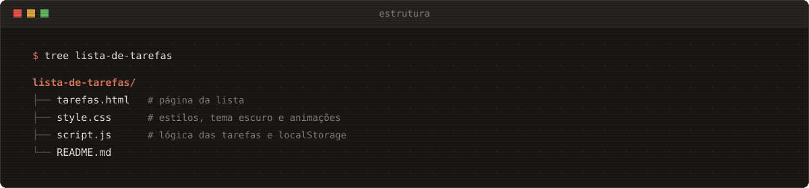

1. Clone o repositório:

```bash
git clone https://github.com/GabrielCardossso/lista-de-tarefas.git
```

2. Abra o arquivo [`tarefas.html`](tarefas.html) no navegador.

Não há nada para instalar nem compilar. Como as tarefas ficam no `localStorage`, elas são guardadas só naquele navegador.

<a href="https://github.com/GabrielCardossso"></a>
